<div align="center">


# PulsarAI

**From conversation to resolution.**

The production marketing site for [pulsaragent.in](https://pulsaragent.in) — an autonomous
customer-operations engine that turns voice, chat, and email into verified, policy-bound action.

<br />


<br />

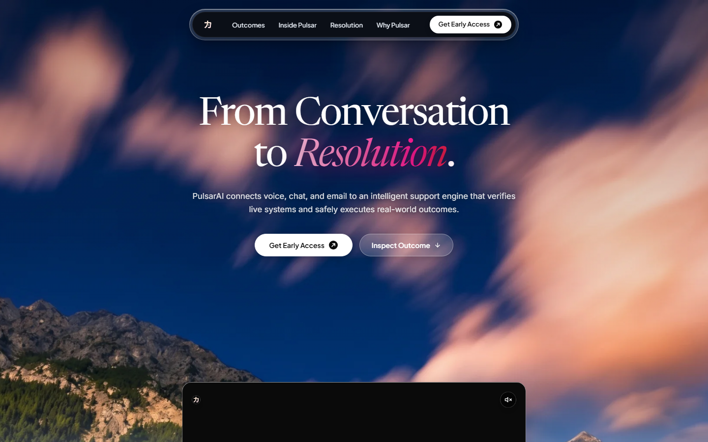

</div>

---

## Contents

- [What this site is](#what-this-site-is)
- [The idea behind Pulsar](#the-idea-behind-pulsar)
- [Page experience](#page-experience)
- [The resolution loop](#the-resolution-loop)
- [Tech stack](#tech-stack)
- [Project structure](#project-structure)
- [Getting started](#getting-started)
- [Early-access pipeline](#early-access-pipeline)
- [Motion and interaction system](#motion-and-interaction-system)
- [Design language](#design-language)
- [Assets](#assets)
- [SEO, accessibility, and performance](#seo-accessibility-and-performance)
- [Deployment notes](#deployment-notes)
- [Credits](#credits)

---

## What this site is

PulsarAI (also written Pulsar AI / Pulsar Agent) is an autonomous customer-operations
platform built by Anarva. Unlike a chatbot that only drafts replies, Pulsar is presented as a
system that can **read a conversation, verify the facts against live business systems, apply
deterministic policy, and then execute the resolution** — or stop and escalate when a rule is
not satisfied.

This repository is the public-facing website for that product. It is a single-page,
long-form landing experience with one job: explain the product's core promise clearly, prove
it visually, and collect early-access requests.

| | |
| --- | --- |
| **Product** | PulsarAI / Pulsar Agent by Anarva |
| **Category** | Autonomous customer support and desktop agents |
| **Core claim** | AI proposes. Deterministic systems decide. |
| **Primary CTA** | Get Early Access |
| **Site type** | Single-page Next.js marketing site with a lead-capture API |
| **Canonical URL** | `https://pulsaragent.in` |

---

## The idea behind Pulsar

The page is structured around one distinction:

> Most AI support tools generate a plausible answer. Pulsar is built to produce a **verified
> outcome**.

That split is repeated in the product narrative and in the UI:

1. **AI understands and investigates** — specialised agents read the conversation, retrieve
   policy, and propose the best resolution.
2. **Pulsar verifies reality** — orders, accounts, transactions, and delivery status are
   checked against the company's live systems before anything is promised.
3. **Deterministic systems decide** — policy, risk, authorization, financial limits, and
   business rules decide what is actually allowed.
4. **Pulsar acts and audits** — authorized actions execute through connected systems, uncertain
   operations are reconciled, and every step lands in an audit trail.

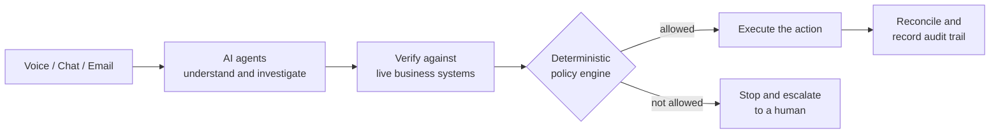

The website itself is designed to feel like that promise: editorial, precise, and calm, with
motion used to demonstrate control rather than spectacle.

---

## Page experience

The landing page is composed section by section in
[`src/pulsar/PulsarLandingPage.tsx`](src/pulsar/PulsarLandingPage.tsx). The fixed glass navbar
links to the four main anchors: **Outcomes**, **Inside Pulsar**, **Resolution**, and
**Why Pulsar**.

| # | Section | Anchor | Component | What it does |
| --- | --- | --- | --- | --- |
| 1 | Hero | — | `PulsarLandingPage` + `TerminalVideoAntigravitySection` | Statement, CTAs, and the product film inside a floating frame |
| 2 | Built on | — | `PulsarLandingPage` | Anarva partner mark |
| 3 | Business outcomes | `#business-outcomes` | `PulsarBusinessOutcomes` | Animated metric tiles with a Production / System toggle |
| 4 | Inside Pulsar | `#inside-pulsar` | `PulsarLandingPage` | AI-vs-human dashboard and the four-step resolution story |
| 5 | Industries | `#Industries` | `Industries` + `IndustryCardArtwork` | Interactive five-card industry deck |
| 6 | Resolution engine | `#support-engine` | `PulsarResolution` | Pinned, scroll-driven six-stage workflow |
| 7 | Why Pulsar | `#why-pulsar` | `WhyPulsarCardsSection` | Four operating principles |
| 8 | Early access | `#early-access` | `PulsarLandingPage` | Email capture wired to `/api/early-access` |
| 9 | Footer | — | `PulsarFooter` | Cinematic poster backdrop, sitemap, and social links |

### Hero and product film

The opening screen pairs an editorial serif headline with a WebP mountain-and-cloud
photograph and a muted, autoplaying product demo. The film scales up on scroll to transition
from "statement" to "proof".


### Business outcomes

A three-card metric deck presents response time, resolution rate, and conversation volume.
A segmented control switches between **Production Lift** (customer-facing numbers) and
**System Scale** (inference latency, context window, connection count). Each card combines a
poster image, a looping background video, and hand-built gauge or counter artwork.

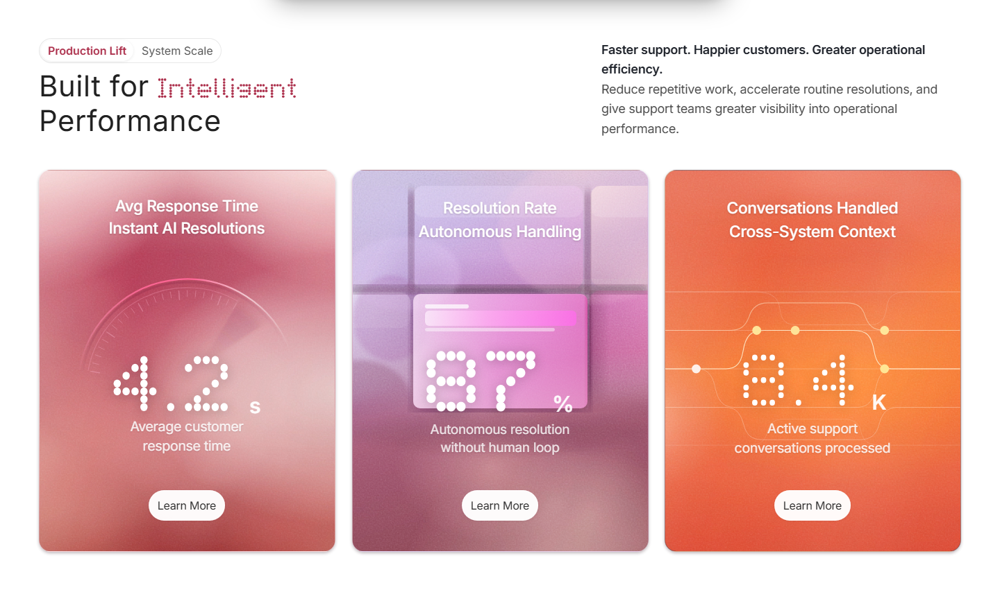

### Inside Pulsar

This section explains the product through a dashboard: conversations handled, resolution
rate, average response, and CSAT — always comparing **AI agents** with the **human team**.
The chart can switch between weekly and monthly views, and the four-step narrative sits
alongside it as a readable sequence.

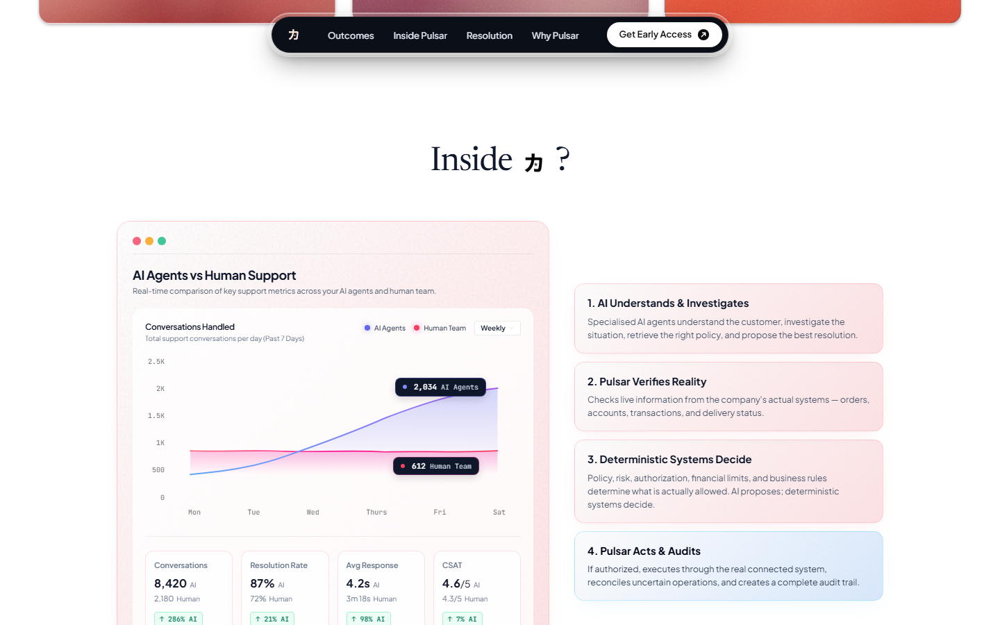

### Industries

Five domain cards — E-commerce & Retail, Technical Support, Financial Services, Healthcare &
Medical, and Telecommunications — are fanned out as a physical deck. Clicking the front card
(or its arrow) advances the stack; clicking a card further back brings it forward. On phones
the deck switches to a narrower transform set so it stays inside the viewport.

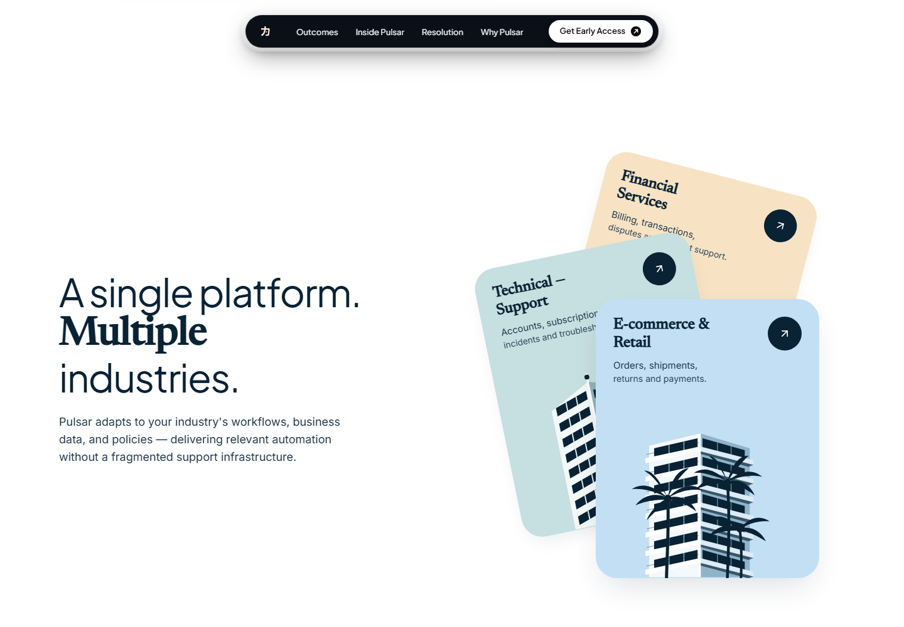

### The resolution engine

The page's signature moment. On desktop the section pins for roughly two viewport heights and
advances through six numbered stages as the user scrolls; on smaller screens it becomes a
normal vertical sequence. The large numeral, the drifting cloud, and the glass panels all
belong to this section's own visual language.

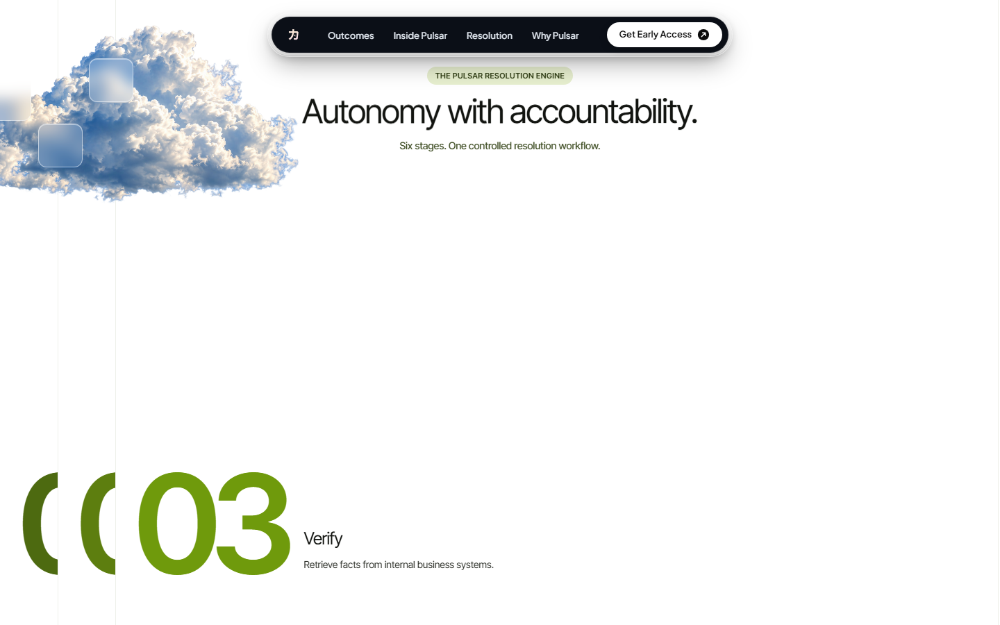

### Why Pulsar

A quiet, high-contrast list of the four guarantees that make autonomy defensible:

- Deterministic decisions
- Verified against live systems
- Safe by construction
- Auditable end to end

The rows reveal as they enter view, using CSS classes toggled by an IntersectionObserver.

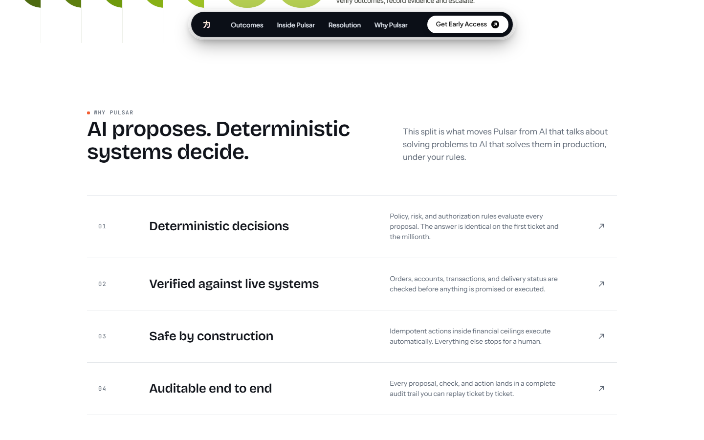

### Early access and footer

The closing section keeps the form deliberately simple: one work email, one button, and a
success state. The footer continues the landscape motif with a poster image (and an optional
looping scene video), a giant ghosted "Pulsar" wordmark, and links to the product, company,
and social destinations.

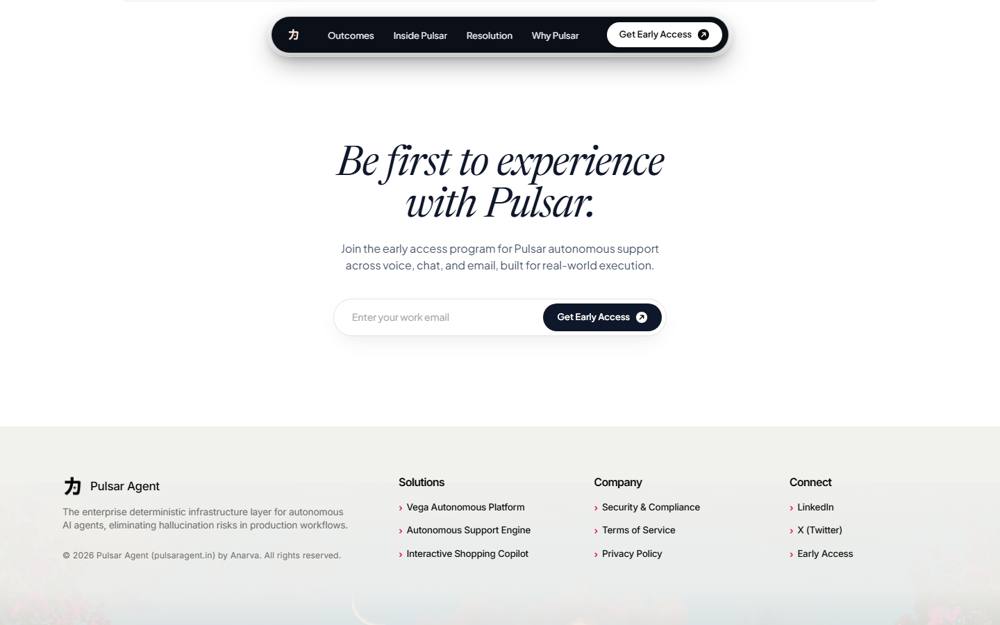

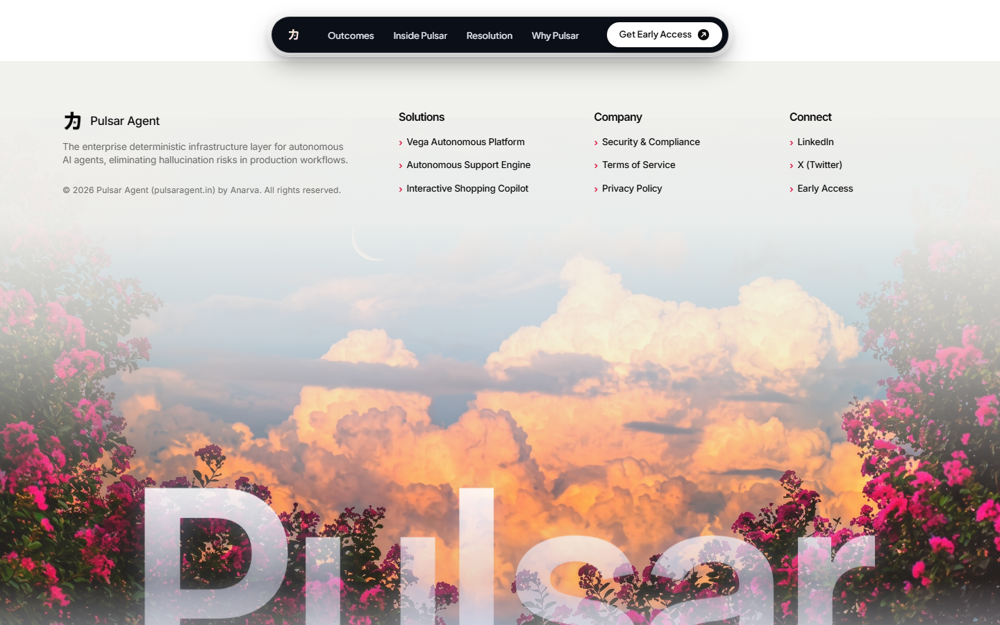

### Mobile

The layout keeps the same narrative order on a 390 px viewport: compact navbar, stacked CTAs,
a scaled film frame, and a compact industry deck. Anchor offsets account for the floating
navbar.

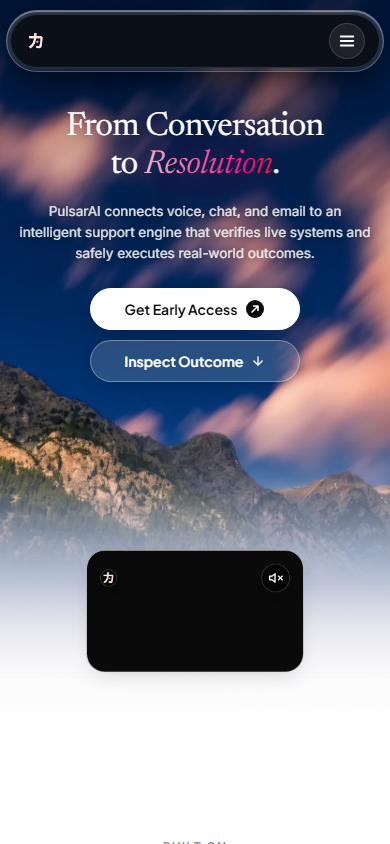

---

## The resolution loop

Every resolution runs the same controlled sequence. The copy lives in
[`src/pulsar/PulsarResolution.tsx`](src/pulsar/PulsarResolution.tsx).

| Stage | Name | Responsibility |
| --- | --- | --- |
| 01 | Read | Ingest the conversation and relevant history |
| 02 | Understand | Classify intent and extract context |
| 03 | Verify | Retrieve facts from internal business systems |
| 04 | Evaluate | Check policies, permissions, and risk |
| 05 | Act | Respond or execute authorized actions |
| 06 | Confirm | Verify outcomes, record evidence, and escalate when needed |

The section is pinned with GSAP `ScrollTrigger` only above 761 px, and the active stage is
derived from scroll progress rather than a timer. That keeps the animation reversible: scrolling
up replays the workflow backwards.

---

## Tech stack

| Layer | Choice | Notes |
| --- | --- | --- |
| Framework | **Next.js 16** (App Router) | Server route for early-access email, metadata API |
| UI | **React 19** + **TypeScript 5.8** | Strict TypeScript |
| Styling | **Tailwind CSS 4** + per-section CSS | Tailwind v4 PostCSS plugin; long-form CSS modules-by-convention |
| Motion | **GSAP 3.15** + **ScrollTrigger** | Pinning, intro timelines, scroll progress |
| Smooth scroll | **Lenis 1.3** | Driven by the GSAP ticker so scroll and animation share one clock |
| Card motion | **Framer Motion 14** | Spring transitions for the industry deck |
| Icons | **Lucide React** | Industry card controls |
| Email | **Nodemailer 10** + Resend HTTP API | Falls back to SMTP, then to a development simulation |
| QA | **Playwright**, **axe-core** | Viewport and accessibility checks during development |

The app is intentionally lightweight: no component library, no CMS, and no runtime animation
framework beyond GSAP and Framer Motion. Section copy is co-located with the components that
render it.

---

## Project structure

```text
pulsar-port/
├─ public/
│  ├─ pulsar-assets/
│  │  ├─ business-outcomes/     # poster + video loops for the metric cards
│  │  ├─ fonts/                 # Inter Tight subset for the resolution section
│  │  ├─ footer/                # footer poster (and optional scene video)
│  │  └─ resolution/            # cloud artwork
│  ├─ pulsar-logo-light.png     # navbar mark
│  ├─ pulsar-logo-dark.png      # favicon, "Inside 力", footer mark
│  ├─ pulsar-og.png             # Open Graph / Twitter card
│  ├─ pulsar-mascot.webp        # brand mascot artwork
│  ├─ anarva-logo.png           # "Built on" partner mark
│  ├─ wmremove-transformed.*    # hero landscape (WebP + PNG fallback)
│  ├─ pulsar-launch-with-music.mp4
│  └─ manifest.json, sw.js
├─ docs/
│  └─ screenshots/              # images used in this README
├─ src/
│  ├─ app/
│  │  ├─ layout.tsx             # metadata, fonts, schema, service worker
│  │  ├─ page.tsx               # renders the landing page
│  │  ├─ globals.css            # Tailwind entry + base styles
│  │  ├─ SchemaOrg.tsx          # Organization / SoftwareApplication / FAQ JSON-LD
│  │  ├─ robots.ts, sitemap.ts
│  │  └─ api/early-access/route.ts
│  ├─ pulsar/
│  │  ├─ PulsarLandingPage.tsx/.css   # hero, nav, partners, inside, CTA
│  │  ├─ TerminalVideoAntigravitySection.tsx
│  │  ├─ PulsarBusinessOutcomes.tsx/.css
│  │  ├─ Industries.tsx
│  │  ├─ IndustryCardArtwork.tsx
│  │  ├─ PulsarResolution.tsx/.css
│  │  ├─ WhyPulsarCardsSection.tsx
│  │  ├─ PulsarFooter.tsx/.css
│  │  ├─ pulsar-system.css
│  │  └─ engine/                # scroll, reveal, interaction, page lifecycle
│  └─ index.css
├─ next.config.mjs
└─ package.json
```

---

## Getting started

### Requirements

- Node.js 20 or newer
- npm (the repository ships with `package-lock.json`)

### Install and run

```bash
npm install
npm run dev
```

Open [http://localhost:3000](http://localhost:3000).

### Scripts

| Command | Purpose |
| --- | --- |
| `npm run dev` | Start the Next.js dev server |
| `npm run build` | Create a production build |
| `npm run start` | Serve the production build |
| `npx tsc --noEmit` | Type-check the whole project |

### Environment variables

Create `.env.local` at the repository root. Every key is optional for local UI work — without
mail credentials the early-access route logs the request and returns success so the form stays
testable.

```bash
# Transactional email — Resend takes precedence when both are configured
RESEND_API_KEY=
EMAIL_FROM="Pulsar Early Access <onboarding@pulsar.systems>"

# Or SMTP / Nodemailer
SMTP_HOST=
SMTP_PORT=587
SMTP_SECURE=false
SMTP_USER=
SMTP_PASS=

# Receives a notification for every new lead (defaults to info@pulsaragent.in)
ADMIN_NOTIFICATION_EMAIL=info@pulsaragent.in
```

`.env.local` is ignored by git. Never commit credentials.

---

## Early-access pipeline

The form in the CTA posts JSON to the App Router handler at
[`src/app/api/early-access/route.ts`](src/app/api/early-access/route.ts).

```http
POST /api/early-access
Content-Type: application/json

{ "email": "person@company.com" }
```

On success the route:

1. Normalizes and validates the address.
2. Appends it to `data/subscribers.json` (created at runtime, ignored by git).
3. Sends a branded welcome email through Resend, or SMTP, or logs a development simulation.
4. Sends a lead notification to `info@pulsaragent.in` (override with
   `ADMIN_NOTIFICATION_EMAIL`).
5. Returns `{ success: true, message, email }`.

```json
{
  "success": true,
  "message": "Priority invite dispatched. Please check your inbox.",
  "email": "person@company.com"
}
```

Invalid addresses return `400`; unexpected failures return `500`. The client shows the
submitting, granted, and error states inline.

---

## Motion and interaction system

All page-wide motion is booted once by `<Engine />`, mounted last in the landing page. The
engine lives in [`src/pulsar/engine/`](src/pulsar/engine/) and is deliberately small:

- **One clock.** Lenis is driven by `gsap.ticker`, and every Lenis scroll calls
  `ScrollTrigger.update()`. This prevents the classic drift between smooth scrolling and
  scroll-triggered animation.
- **Scoped lifecycles.** Components register effects through `usePage()`; the engine keeps them
  in a `gsap.context` and reverts everything on unmount, so React Strict Mode does not double
  animations.
- **Progressive reveals.** Elements with `.ps-reveal` are revealed by an
  `IntersectionObserver` that adds `.is-in`. Without JavaScript, or with reduced motion, the
  content is visible immediately.
- **Reduced motion.** `prefers-reduced-motion` disables Lenis, skips the intro timelines, and
  marks all reveals as visible.
- **Pinned storytelling.** The resolution section uses `gsap.matchMedia()` to pin only on
  desktop (`min-width: 761px`) for `2 × innerHeight`, replaying cleanly on refresh.
- **Direct manipulation.** The industry deck is ordered in React state and animated by
  Framer Motion springs, with a separate compact transform set below 640 px.

---

## Design language

The site moves between two registers:

- **Editorial light** — warm white, ink navy, oversized serif/sans headlines, fine rules, and
  soft pastel surfaces. Used for outcomes, the dashboard, industries, and the principles.
- **Cinematic dark** — deep blue night skies, cloud photography, glass capsules, and the pink
  `Resolution` accent. Used for the hero and footer.

Type is loaded in [`src/app/layout.tsx`](src/app/layout.tsx): **Newsreader** for italic serif
accents, **Inter** for body copy, **JetBrains Mono** for technical labels, plus Plus Jakarta
Sans, Bricolage Grotesque, and Instrument Sans for display moments. The resolution section
self-hosts an **Inter Tight** subset from `public/pulsar-assets/fonts/`.

The navbar is a floating glass capsule with anchor links; each anchor has an 88 px scroll
margin so the fixed header never covers a section heading. `overflow-x` is contained at the
page and section level, including the intentionally rotated card deck.

> **Note on numbers:** the dashboard and metric tiles are product storytelling surfaces. The
> values are presentation data, not a live telemetry feed.

---

## Assets

All imagery is local to the repository — no third-party image CDN is required at runtime.

| Preview | File | Where it is used |
| --- | --- | --- |
|  | `public/pulsar-logo-dark.png` | Favicon, "Inside 力" glyph, footer mark |
|  | `public/pulsar-logo-light.png` | Navbar mark, film badge |
|  | `public/anarva-logo.png` | "Built on" partner row |
|  | `public/pulsar-mascot.webp` | Brand mascot artwork |
| 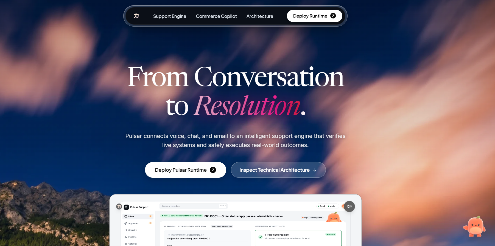 | `public/pulsar-og.png` | Open Graph and Twitter card |
|  | `public/wmremove-transformed.webp` | Hero background (PNG fallback alongside) |
|  | `public/pulsar-assets/resolution/cloud.png` | Resolution engine backdrop |
|  | `public/pulsar-assets/footer/scene-poster.png` | Footer poster frame |

Additional media:

| File | Notes |
| --- | --- |
| `public/pulsar-launch-with-music.mp4` | Hero product film (autoplay, muted, loops) |
| `public/pulsar-assets/business-outcomes/card-*.mp4` | Three looping metric-card videos |
| `public/pulsar-assets/business-outcomes/card-*-poster.png` | Poster frames for the same cards |
| `public/pulsar-assets/fonts/inter-tight-latin.woff2` | Self-hosted display font |
| `public/manifest.json`, `public/sw.js` | Installable PWA metadata and service worker |

If a footer `scene.mp4` is not present, the footer still renders its poster frame; the layout
does not depend on the video being available.

---

## SEO, accessibility, and performance

**SEO**

- Title templates, description, keywords, canonical URL, Open Graph, and Twitter cards are set
  in `src/app/layout.tsx`.
- JSON-LD in [`src/app/SchemaOrg.tsx`](src/app/SchemaOrg.tsx) describes the organization, the
  software application, the product video, and an FAQ.
- `robots.ts` allows search and AI crawlers while excluding private paths; `sitemap.ts` publishes
  the canonical URL and section anchors.
- Intentional plural naming ("PulsarAI", "Pulsar AI", "Pulsar Agent", "Apache Pulsar"
  disambiguation) is used throughout the metadata.

**Accessibility**

- Reduced-motion support across scroll, reveals, and intro timelines.
- Semantic landmarks (`header`, `main`, `section`, `footer`, `nav`) and labelled icon buttons.
- Descriptive `alt` text for content images; decorative artwork is marked `aria-hidden`.
- Anchor navigation and mobile menu controls expose `aria-expanded` and `aria-label`.
- The industry deck is operable by click, not hover alone.

**Performance**

- The hero landscape is preloaded and served as WebP with a PNG fallback.
- Videos use poster frames and `preload="metadata"`; the footer video only plays in view.
- Fonts are preconnected; the resolution section's font is self-hosted.
- `next.config.mjs` sets `images.unoptimized: true`, so all assets are served as authored.
- Section CSS is split by feature rather than shipped as one global stylesheet.

---

## Deployment notes

The site is a standard Next.js application and can be deployed to any host that runs Node.js.

```bash
npm run build
npm run start
```

Two things to keep in mind:

- **The API route needs a Node runtime** (Nodemailer) and outbound network access for Resend or
  SMTP.
- **Local lead storage is filesystem-based.** `data/subscribers.json` works on a persistent
  server or volume, but not on ephemeral serverless filesystems. In a serverless deployment,
  treat the transactional email provider (or a durable database) as the source of truth for
  leads.

Set the environment variables from [Getting started](#getting-started) in the hosting
provider's dashboard.

---

## Credits

Designed and built for **PulsarAI** by **Anarva**.
Copyright © 2026 Pulsar Agent ([pulsaragent.in](https://pulsaragent.in)). All rights reserved.

- LinkedIn: [Pulsar Agent](https://www.linkedin.com/company/pulsar-agent-ai)
- X: [@PulsarAgentAI](https://x.com/PulsarAgentAI)
